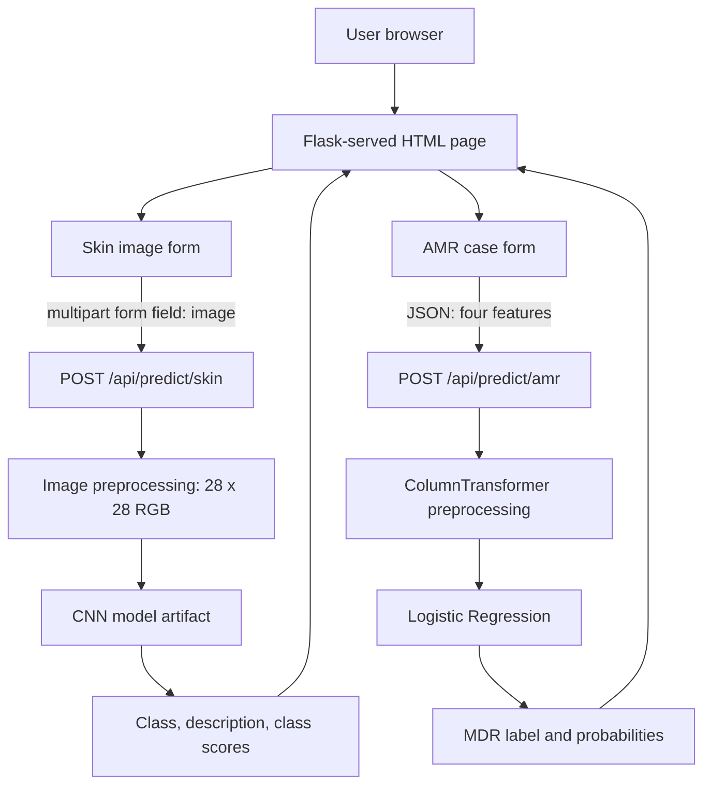

# PROJECT_CONTEXT_HANDOVER.md

# AI-Driven Skin Disease Classification and AMR Prediction

**Document type:** Technical project handover\
**Context cutoff:** 31 October 2026\
**Primary development environment:** Windows desktop, VS Code, Python
3.11.6\
**Current application:** Local Flask web application\
**Status at handover:** Both model pipelines and browser prediction
workflows have worked locally. UI/UX refinement is underway. Some latest
frontend changes remain unverified.

------------------------------------------------------------------------

## Executive summary

This project is a local web application that demonstrates two
independent machine-learning workflows:

1.  **Skin Disease Classification:** A CNN classifies a supplied
    skin-lesion image into one of seven DermaMNIST categories.
2.  **AMR Prediction:** A Logistic Regression pipeline predicts MDR / No
    MDR from four structured case features.

The models share a Flask application and browser interface, but they are
not a combined model. They have separate input forms, API routes,
preprocessing paths, and result panels.

The project is intended for academic, research, and educational
demonstration. Neither model should be represented as clinically
validated, used for diagnosis, or used to make antibiotic or treatment
decisions.

Local project root:

``` text
C:\Users\ssank\OneDrive\Desktop\AMR Project\skindisease project 2
```

Local interface:

``` text
http://127.0.0.1:5000/app
```

Both models loaded successfully after aligning local library versions
with the versions used to serialize the artifacts. The Flask app ran
locally, skin image upload and prediction worked, and AMR prediction
returned a class and probabilities. The current workstream is UI/UX
refinement.

**Critical user workflow preference:** Work one step at a time. Give one
concrete next action, specify the exact file and code location, and wait
for the user's result before continuing. Do not overwhelm the user with
multiple implementation steps in one response.

------------------------------------------------------------------------

# 1. Project overview and objectives

## 1.1 Project identity and purpose

Project name used in the conversation:

**AI-Driven Skin Disease Classification and AMR Prediction**

Other informal references include "Skin Disease Classification and AMR
Prediction" and a local folder named `skindisease project 2`.

The purpose is to demonstrate: - Image-based skin-lesion classification
using a CNN. - Structured-data MDR classification using a Logistic
Regression pipeline. - Integration of both inference workflows into one
browser-accessible Flask application.

The available history does not establish a clinically validated problem
statement, clinical deployment plan, hospital integration, prospective
study, or intended use by patients or clinicians in actual care.

## 1.2 Project type and stakeholders

Established: - Student/academic project in a research/educational
context. - Developer is a B.Tech CSE (AI/ML) student. - The local web
application is intended to demonstrate model inference.

Not established: - Whether this is formally a group project. - Team
members, faculty guide, clinical partners, or dataset owners. - Formal
university rubric, submission date, or presentation schedule. -
Commercial or startup objectives.

Do not invent stakeholder roles or commitments.

## 1.3 Confirmed functional requirements

  ---------------------------------------------------------------------------
  ID                      Requirement                 Status
  ----------------------- --------------------------- -----------------------
  FR-01                   Load a trained CNN from a   Implemented and locally
                          local model artifact        verified

  FR-02                   Accept a skin image upload  Implemented and tested
                          in the browser              

  FR-03                   Preprocess image to the     Implemented; inspect
                          CNN's 28 × 28 RGB input     code for exact
                                                      resize/normalization
                                                      details

  FR-04                   Display predicted skin      Implemented and tested
                          class and description       

  FR-05                   Display CNN class scores    Implemented
                          when returned               

  FR-06                   Load serialized AMR         Implemented and locally
                          scikit-learn pipeline       verified

  FR-07                   Accept Year Case, Sex, Age  Implemented and tested
                          Group, On Abx               

  FR-08                   Display MDR / No MDR        Implemented and tested
                          prediction and              
                          probabilities               

  FR-09                   Keep model workflows        Confirmed architecture
                          separate                    

  FR-10                   Display                     Implemented
                          research/educational-only   
                          disclaimers                 

  FR-11                   Preview selected image      Implemented; visual
                          before classification       details should be
                                                      rechecked

  FR-12                   Show loading state while    User confirmed changes
                          inference runs              applied

  FR-13                   Render AMR probabilities as Proposed; not confirmed
                          horizontal bars             applied
  ---------------------------------------------------------------------------

## 1.4 Non-functional requirements and constraints

-   Windows local development using VS Code.
-   Flask backend; HTML/CSS/JavaScript frontend.
-   Existing model artifacts and endpoints should remain functional
    during UI work.
-   Do not retrain, replace, or alter models unless explicitly required.
-   Preserve the current model-compatible dependency versions.
-   Keep research/educational disclaimers visible and unambiguous.
-   Prefer incremental changes and verify each change.
-   No production hosting, authentication, database, or CI/CD
    requirements have been established.

## 1.5 Original vision and evolution

The current known scope is a single local web app with two prediction
cards. UI refinements have included a modern dashboard appearance, image
preview, responsive layout, card hover, loading spinners, and score
bars.

The user selected **UI/UX improvement** as the immediate priority and
selected **charts, history, and validation** as optional features to
consider. Those optional features are not all implemented. The exact
history persistence approach and charting library have not been
selected.

------------------------------------------------------------------------

# 2. Complete conversation-derived context

## 2.1 Two distinct ML workflows

The CNN consumes an image and predicts one of seven skin-lesion
categories. The AMR pipeline consumes four structured fields and
predicts an MDR label. Do not combine the features, outputs, training
data, or model artifacts.

## 2.2 Important implementation and UX corrections

-   The correct skin upload multipart field is `image`. A previous
    request failed because the backend did not receive that exact field
    name.
-   The preview image element uses `id="image-preview"` (hyphenated),
    not `imagePreview`.
-   The current interface is believed to be `templates/app.html`, served
    at `/app`. Earlier discussion mentioned `templates/index.html`;
    verify the actual `render_template(...)` target before editing.
-   A prior preview appeared too small. The selector and dimensions were
    corrected; the user replied `done`, but the exact latest appearance
    was not independently confirmed by a final screenshot.
-   The user confirmed card hover styling and loading-state JavaScript
    changes by replying `done`.
-   The AMR probability-bar replacement was supplied after the last
    confirmed step. It is pending user confirmation.
-   The user prefers exact, focused code edits over broad instructions.
-   Do not assume that a proposed code block was applied just because it
    was supplied.

## 2.3 Current browser experience

The page has two cards: - Skin Disease Classification: image selection,
image preview, classify button, predicted class, description, score
bars, and notice. - AMR Prediction: four fields, run button, predicted
class, probability output, and notice.

A previous browser test displayed the skin class `nv` / "Melanocytic
nevi". A previous AMR test displayed MDR with probability 0.798246 and
No MDR with probability 0.201754 for the supplied example features.

------------------------------------------------------------------------

# 3. Current technical architecture

## 3.1 Implemented architecture



## 3.2 Frontend

-   HTML template rendered by Flask.
-   CSS embedded in a `<style>` block.
-   JavaScript embedded in `<script>` blocks.
-   No separate frontend build pipeline has been established.
-   No React/Vue/Angular frontend is part of the confirmed current
    implementation.

Important DOM IDs: - `skinForm` - `skinImage` -
`image-preview-container` - `image-preview` - `skinButton` -
`skinResult` - `amrForm` - `amrButton` - `amrResult` - `yearCase` -
`sex` - `ageGroup` - `onAbx`

Skin input markup observed:

``` html
<input type="file" id="skinImage" name="image" accept="image/*" required>
```

The FileReader preview script reads the selected image as a data URL and
reveals `image-preview-container`. It checks that the file MIME type
starts with `image/`. This browser-side check does not replace
server-side validation.

## 3.3 Backend and routes

-   Flask app: `src/app.py`
-   Browser route: `GET /app`
-   Skin inference: `POST /api/predict/skin`
-   AMR inference: `POST /api/predict/amr`
-   Local server: `127.0.0.1:5000`

Exact backend code and complete response schemas were not available in
the handover context. Inspect `src/app.py` before changing routes,
preprocessing, label mapping, validation, or model loading.

No database, authentication, authorization, cloud service, external
clinical integration, production WSGI deployment, or CI/CD pipeline has
been established.

## 3.4 Skin API contract observed

Method: `POST`\
Path: `/api/predict/skin`\
Content type: multipart form data\
Required field name: `image`

Frontend request:

``` javascript
const formData = new FormData();
formData.append("image", file);

const response = await fetch("/api/predict/skin", {
    method: "POST",
    body: formData
});
```

Successful response fields observed: - `predicted_class` -
`description` - `notice` - `class_scores` (frontend conditionally checks
this field)

Exact `class_scores` schema and normalization/calibration semantics are
not established.

## 3.5 AMR API contract observed

Method: `POST`\
Path: `/api/predict/amr`\
Content type: JSON

Example request:

``` json
{
  "Year Case": 2024,
  "Sex": "F",
  "Age Group": "19-35",
  "On Abx": "Yes"
}
```

Successful response fields observed: - `predicted_class` -
`predicted_label` - `class_probabilities` - `features_used` - `notice`

Example response:

``` json
{
  "class_probabilities": {
    "MDR": 0.798246,
    "No MDR": 0.201754
  },
  "features_used": {
    "Age Group": "19-35",
    "On Abx": "Yes",
    "Sex": "F",
    "Year Case": 2024.0
  },
  "notice": "Research and educational use only. This result is not a clinical prediction for treatment decisions.",
  "predicted_class": "MDR",
  "predicted_label": 1
}
```

This is a single example, not a general performance result.

------------------------------------------------------------------------

# 4. AI/ML models, datasets, and evaluation

## 4.1 CNN skin classifier

Artifact:

``` text
models/rebuilt_baseline_cnn.keras
```

Training context: Google Colab, DermaMNIST dataset. The baseline CNN was
selected over weighted variants.

Model dimensions: - Input: `(None, 28, 28, 3)` - Output: `(None, 7)` -
Parameters: `157,735`

Class mapping:

    Index Code      Description
  ------- --------- -------------------------------------------------
        0 `akiec`   Actinic keratoses and intraepithelial carcinoma
        1 `bcc`     Basal cell carcinoma
        2 `bkl`     Benign keratosis-like lesions
        3 `df`      Dermatofibroma
        4 `mel`     Melanoma
        5 `nv`      Melanocytic nevi
        6 `vasc`    Vascular lesions

Reported held-out results:

  Metric                 Value
  ------------------- --------
  Accuracy              0.7686
  Balanced accuracy     0.5507
  Macro F1              0.5661
  Weighted F1             0.76
  `df` recall             0.22
  `df` support              23

The accuracy/balanced-accuracy gap and weak `df` recall indicate
class-level performance limitations. Do not imply equal performance
across all classes.

One successful response:

``` json
{
  "description": "Melanocytic nevi",
  "notice": "Research and educational use only. This result is not a clinical diagnosis.",
  "predicted_class": "nv"
}
```

A screenshot showed a 100% class score for that prediction. This does
not establish calibration or clinical certainty.

## 4.2 AMR Logistic Regression pipeline

Artifacts:

``` text
models/amr_logistic_pipeline.joblib
models/model_metadata.json
```

Pipeline inspected: - `ColumnTransformer` - Numeric `Year Case`: median
imputation + standard scaling - Categorical `Sex`, `Age Group`,
`On Abx`: most-frequent imputation +
`OneHotEncoder(handle_unknown="ignore")` -
`LogisticRegression(max_iter=2000, random_state=42)`

Feature names:

``` python
["Year Case", "Sex", "Age Group", "On Abx"]
```

UI options: - `Sex`: `F`, `M` - `Age Group`: `13-18`, `19-35`, `36-59`,
`≤12`, `≥60` - `On Abx`: `No`, `Yes` - `Year Case`: numeric year; 2024
used in browser test

Pipeline classes printed as `[0 1]`. Application convention observed:
`0 = No MDR`, `1 = MDR`. Verify the actual backend/training mapping
before changing it.

Metadata reported:

``` json
{
  "model_type": "Logistic Regression",
  "target": "MDR Pathogen",
  "positive_class": "Yes",
  "negative_class": "No",
  "features": [
    "Year Case",
    "Sex",
    "Age Group",
    "On Abx"
  ],
  "classification_threshold": 0.5,
  "training_records": 171,
  "class_counts": {
    "0": 92,
    "1": 79
  },
  "trained_at_utc": "2026-10-18T13:35:29.455391Z",
  "evaluation_note": "Exploratory model. Cross-validation results are not independent clinical validation."
}
```

The metadata uses string positive/negative labels `"Yes"`/`"No"` while
model classes are numeric and UI output uses MDR/No MDR. This deserves
verification against training code.

Reported five-fold stratified cross-validation:

  Metric                 Value
  ------------------- --------
  Accuracy              0.6257
  Balanced accuracy     0.6236
  MDR precision         0.5949
  MDR recall            0.5949
  MDR F1                0.5949
  Macro F1              0.6236
  ROC-AUC               0.6217

Confusion matrix:

``` text
[[60, 32],
 [32, 47]]
```

Training records: 171; class counts: 92 No MDR and 79 MDR. There were 32
MDR false negatives. Treat this model as exploratory, not clinically
validated.

## 4.3 Data resources

Google Drive root:

``` text
/content/drive/MyDrive/AMR_Project
```

Known resources: - `Rebuilt_Experiments/rebuilt_baseline_cnn.keras` -
`AMR_Model/amr_logistic_pipeline.joblib` -
`AMR_Model/model_metadata.json` - `data/SSTI_Dataset-JRRH.xlsx`

The user downloaded the model files and placed them in the local
`models` folder. The Drive originals were not modified.

A test image was referenced at:

``` text
C:\Users\ssank\OneDrive\Desktop\AMR Project\SkinDisease_AMR_Project\test_skin_image.png
```

It is outside the current project root. Do not assume it is still
present.

------------------------------------------------------------------------

# 5. Implementation status and codebase

## 5.1 Known project tree

``` text
skindisease project 2/
├── assets/
├── models/
│   ├── rebuilt_baseline_cnn.keras
│   ├── amr_logistic_pipeline.joblib
│   └── model_metadata.json
├── src/
│   ├── app.py
│   └── verify_models.py
├── tests/
├── templates/
│   └── app.html
└── .venv/
```

This is a partial known structure, not a verified exhaustive listing.
`assets/` and `tests/` contents were not inspected.

## 5.2 Component status

  -------------------------------------------------------------------------
  Component                 Status                  Evidence / caveat
  ------------------------- ----------------------- -----------------------
  CNN artifact              Working                 Loaded and synthetic
                                                    inference passed

  AMR artifact              Working                 Loaded and sample
                                                    inference passed

  Flask server              Working                 Started locally

  `/app` page               Working                 Browser rendered both
                                                    cards

  Skin endpoint             Working                 Successful browser
                                                    prediction

  AMR endpoint              Working                 Successful browser
                                                    prediction

  Skin image preview        Implemented             User confirmed changes;
                                                    exact latest appearance
                                                    should be rechecked

  Modern dashboard CSS      Applied                 User continued with
                                                    design

  Responsive styling        Added                   Multiple breakpoints
                                                    may overlap

  Card hover                User confirmed applied  User replied `done`

  Loading spinner CSS       Added                   User replied `done`

  Loading spinner JS        Added                   User replied `done`

  CNN score bars            Existing                Rendered in skin result

  AMR score bars            Proposed                Latest change not
                                                    confirmed

  Prediction history        Not implemented         Selected as optional
                                                    feature

  Dedicated analytics       Not implemented         Selected as optional
  charts                                            feature

  Robust validation         Partial                 Browser checks and API
                                                    error handling exist

  Automated tests           Unknown                 `tests/` exists,
                                                    contents not inspected

  Database/authentication   Not established         No evidence of
                                                    implementation

  Production deployment     Not established         Local development
                                                    server only
  -------------------------------------------------------------------------

## 5.3 Frontend JavaScript structure

The main script includes: - References to both forms, result areas, and
buttons. - `showError(element, message)`. -
`addText(parent, tag, text, className)`. - `readResponse(response)`.

`readResponse` parses JSON and throws an error for non-success HTTP
status, using the backend `error` field where available. `showError`
renders messages using `textContent`.

Skin form behavior: - Checks file presence and browser MIME type. -
Hides previous result. - Disables button and changes label to
`Classifying...`. - Sends multipart form data to `/api/predict/skin`. -
Renders predicted class, description, scores, and notice. - Restores
button in `finally`.

AMR form behavior: - Reads the four input values. - Converts `Year Case`
to a number. - Sends JSON to `/api/predict/amr`. - Renders predicted
class, probabilities, and notice. - Restores button in `finally`.

The separate image-preview script uses `FileReader`.

------------------------------------------------------------------------

# 6. UI/UX and design decisions

## 6.1 Visual direction

The accepted direction is a modern, clean blue dashboard: - Pale
blue-gray page background. - Navy-to-blue gradient header. - White
rounded cards. - Subtle shadows. - Blue primary buttons. - Muted slate
text. - Amber research disclaimer. - Responsive card grid.

No Figma file, design source, or external visual reference is known.

## 6.2 CSS tokens reported

``` css
:root {
    --primary: #3157e8;
    --primary-dark: #2444c7;
    --background: #f4f7fc;
    --surface: #ffffff;
    --text: #17233b;
    --muted: #64748b;
    --border: #e0e7f2;
    --success: #15803d;
    --danger: #b91c1c;
    --shadow: 0 12px 32px rgba(24, 43, 86, 0.07);
}
```

Header gradient used:

``` css
linear-gradient(125deg, #14234f 0%, #254bc5 65%, #3975f5 100%)
```

## 6.3 Image preview CSS

The correct selector is `#image-preview`, matching the hyphenated HTML
ID:

``` css
#image-preview {
    display: block;
    width: 100%;
    max-width: 320px;
    height: auto;
    aspect-ratio: 1 / 1;
    object-fit: contain;
    background: #f8fafc;
    border: 1px solid var(--border);
    border-radius: 12px;
    padding: 4px;
    margin-top: 12px;
    box-shadow: 0 4px 14px rgba(15, 23, 42, 0.06);
}
```

The earlier incorrect selector `#imagePreview` was corrected after the
user shared the actual markup. The user said `done` after the corrected
preview styling.

## 6.4 Card hover styling

User confirmed application of:

``` css
.card {
    background: var(--surface);
    border: 1px solid var(--border);
    border-radius: 18px;
    padding: 28px;
    box-shadow: 0 8px 24px rgba(15, 23, 42, 0.05);
    transition: transform 0.2s ease, box-shadow 0.2s ease,
                border-color 0.2s ease;
}

.card:hover {
    transform: translateY(-3px);
    border-color: #b7ccff;
    box-shadow: 0 14px 32px rgba(37, 99, 235, 0.10);
}
```

## 6.5 Loading state

CSS uses `button.is-loading`, a `::before` spinner,
`@keyframes button-spin`, and a reduced-motion media query. The
JavaScript adds/removes `is-loading` around both requests. User
confirmed the JavaScript hookup by replying `done`.

Expected labels: - Skin: `Classifying...` then `Classify Image` - AMR:
`Running model...` then `Run AMR Model`

## 6.6 Pending AMR score-bar change

The assistant supplied the following replacement for the AMR
`class_probabilities` rendering block, but user confirmation is absent:

``` javascript
if (data.class_probabilities) {
    addText(amrResult, "h4", "Model scores");

    for (const [name, score] of
        Object.entries(data.class_probabilities)) {
        const numericScore = Number(score);
        const percentage = Math.max(
            0,
            Math.min(100, numericScore * 100)
        );

        const row = document.createElement("div");
        row.className = "score-row";

        const label = document.createElement("div");
        label.className = "score-label";

        const nameSpan = document.createElement("span");
        nameSpan.textContent = name;

        const scoreSpan = document.createElement("span");
        scoreSpan.textContent = percentage.toFixed(2) + "%";

        label.append(nameSpan, scoreSpan);

        const bar = document.createElement("div");
        bar.className = "bar";

        const fill = document.createElement("div");
        fill.className = "bar-fill";
        fill.style.width = percentage + "%";

        bar.appendChild(fill);
        row.append(label, bar);
        amrResult.appendChild(row);
    }
}
```

Do not claim it is implemented until confirmed by inspecting the file or
testing the UI.

------------------------------------------------------------------------

# 7. Decision log

  ---------------------------------------------------------------------------------------------------------
  Decision           Chosen approach    Reasoning             Alternatives        Status
                                                              considered          
  ------------------ ------------------ --------------------- ------------------- -------------------------
  Model architecture Two independent    Different             One combined model  Confirmed
                     models in one      inputs/tasks                              
                     Flask app                                                    

  CNN artifact       Baseline CNN       Selected in prior     Weighted variants   Confirmed
                                        model work                                

  CNN input          28 × 28 RGB        Model input shape     Higher-resolution   Confirmed
                                                              input               

  CNN labels         Seven DermaMNIST   Output dimension and  Alternative mapping Confirmed
                     classes            mapping                                   

  AMR model          Saved Logistic     Existing trained      Other classifiers   Current choice
                     Regression         artifact                                  
                     pipeline                                                     

  AMR features       Four established   Matches pipeline      Additional features Confirmed
                     fields                                                       

  Frontend           HTML/CSS/JS        Existing working      Separate SPA        Not selected
                                        implementation        framework           

  Backend            Flask              Existing working      Node/Express        Not selected for this
                                        server                                    project

  Model storage      `.keras` and       Local artifact        Retrain on startup  Confirmed
                     `.joblib` files    loading                                   

  Python             3.11.6             Current working       Python 3.14         Not selected
                                        environment                               

  TensorFlow/Keras   2.18.0 / 3.15.1    Fixed CNN             2.15.1 / 2.15.0     Older versions failed
                                        deserialization issue                     

  scikit-learn       1.6.1              Fixed AMR pickle      1.4.2               Older version failed
                                        compatibility                             

  UI route           `/app`             Actual interface      `/`                 Confirmed
                                        route                                     

  Skin multipart     `image`            Required by backend   Other field names   Confirmed
  field                                                                           

  Preview selector   `#image-preview`   Matches DOM ID        `#imagePreview`     Corrected

  Visual style       Blue dashboard     User continued with   Plain styling       Current direction
                                        design                                    

  Loading state      CSS spinner + JS   Visible inference     Static button       User-confirmed
                     class toggles      feedback                                  

  AMR score bars     Reuse existing     Consistency with CNN  Text-only           Proposed; unverified
                     score-bar CSS                            percentages         

  History            Not yet selected   Persistence/privacy   Session, local      Planned only
                     technically        choice unresolved     storage, SQLite     

  Charts             No library         Avoid unnecessary     Chart.js / CSS bars Planned only
                     selected           dependency                                

  Database           None established   No persistence        SQLite or other DB  Not
                                        requirement confirmed                     implemented/established

  Deployment         Local development  No target supplied    Cloud hosting       Not established
                     only                                                         
  ---------------------------------------------------------------------------------------------------------

------------------------------------------------------------------------

# 8. Development environment and workflow

## 8.1 Local development setup

Known environment:

  Item                  Established value
  --------------------- --------------------------------------------------------
  Operating system      Windows desktop
  Editor                Visual Studio Code
  Shell examples        PowerShell
  Python                3.11.6, 64-bit
  Virtual environment   `.venv` in project root
  Flask                 3.1.3
  TensorFlow            2.18.0
  Keras                 3.15.1
  scikit-learn          1.6.1
  Flask-CORS            Installed/imported successfully; exact version unknown
  pandas                Installed/imported successfully; exact version unknown
  NumPy                 Installed/imported successfully; exact version unknown
  joblib                Installed/imported successfully; exact version unknown

The exact versions of Flask-CORS, pandas, NumPy, and joblib were not
recorded. No `requirements.txt`, `pyproject.toml`, lock file, or Conda
environment file was confirmed.

## 8.2 Prerequisites

-   Windows with PowerShell.
-   Python 3.11.6 64-bit installed.
-   VS Code.
-   Project folder and local model artifacts.
-   Python packages installed in `.venv`.
-   Browser capable of accessing localhost.

The model artifacts must exist at the paths expected by `src/app.py` /
`src/verify_models.py`. Confirm paths in code rather than assuming
working-directory behavior.

## 8.3 Virtual environment workflow

Project root:

``` powershell
cd "C:\Users\ssank\OneDrive\Desktop\AMR Project\skindisease project 2"
```

Activate:

``` powershell
.\.venv\Scripts\Activate.ps1
```

The user previously asked whether activation could be avoided each time.
No persistent solution was confirmed. A safe operational approach is to
use the virtual environment's interpreter explicitly:

``` powershell
.\.venv\Scripts\python.exe .\src\app.py
```

This avoids relying on shell activation for that command, but it was not
recorded as tested by the user. Alternatively, configure the VS Code
interpreter to `.venv\Scripts\python.exe`; confirm the selected
interpreter in VS Code.

## 8.4 Model verification and startup commands

Run model checks from the project root:

``` powershell
python .\src\verify_models.py
```

Start Flask:

``` powershell
python .\src\app.py
```

Open:

``` text
http://127.0.0.1:5000/app
```

Stop the server with `Ctrl + C`. After HTML/CSS/JS changes, save and
hard-refresh the browser using `Ctrl + F5`.

The Flask development server ran in debug mode and restarted after file
changes. Its built-in server is for local development, not production
deployment.

## 8.5 Latest successful verification output

Reported output:

``` text
===== CNN =====
Input shape: (None, 28, 28, 3)
Output shape: (None, 7)
Parameters: 157,735
Synthetic-image output shape: (1, 7)

===== AMR =====
Features: ['Year Case', 'Sex', 'Age Group', 'On Abx']
Classes: [0 1]
Sample prediction: MDR
Probabilities: {'0': 0.4214, '1': 0.5786}

Metadata target: MDR Pathogen

All local model-loading checks passed.
```

Exact synthetic sample values were not recorded.

## 8.6 Package management

Package installation and upgrades were performed with `pip`. The history
confirms upgrades to address model serialization compatibility, but not
a complete reproducible install command or dependency manifest.

Check installed versions:

``` powershell
python --version
python -m pip show tensorflow keras scikit-learn Flask
python -m pip freeze
```

Do not casually upgrade or downgrade TensorFlow, Keras, or scikit-learn.
The saved artifacts previously failed under older versions.

If a dependency manifest is later created, pin the working versions and
verify a clean environment before replacing the existing `.venv`.

## 8.7 Environment variables and secrets

No required environment variable names were established. No API keys,
passwords, access tokens, or other credentials were supplied in the
known project context.

Do not invent environment variable names. If secrets become necessary,
use placeholders in documentation and store actual values outside source
control (for example, in a local `.env` file excluded by `.gitignore`).
No such `.env` setup is currently confirmed.

## 8.8 Git workflow

Unknown: - Whether the current folder is a Git repository. - Remote
URL. - Branch names. - Commit hashes. - Pull requests. - Branching or
review conventions.

No Git workflow, merge procedure, or CI process was established. Verify
with:

``` powershell
git status
git remote -v
git branch --show-current
git log -1 --oneline
```

Do not claim a repository URL or commit history without checking.

## 8.9 Build, lint, test, and deployment commands

Confirmed: - Model verification: `python .\src\verify_models.py` - Local
server: `python .\src\app.py`

Not established: - Dedicated frontend build command. - Linter or
formatter. - Automated test command. - Docker build/run commands. -
CI/CD pipeline. - Production deployment command.

A `tests/` directory exists, but its contents and test runner are
unknown. Inspect it before proposing a new test framework.

## 8.10 Operating-system-specific considerations

-   Commands shown use PowerShell syntax.
-   Virtual environment activation is `.\.venv\Scripts\Activate.ps1`.
-   Windows PowerShell execution policy may affect activation; no exact
    execution-policy error was reported.
-   A previous Python 3.14 environment attempt failed (see Section 9).
    The working environment is Python 3.11.6.
-   The project is under OneDrive-synced Desktop. Potential file-sync or
    path-lock behavior has not been reported; do not assume it caused
    any issue.

------------------------------------------------------------------------

# 9. Errors, debugging history, and unresolved issues

## 9.1 Issue register

  --------------------------------------------------------------------------------------------------------------------------------------------------------------------------------------------------------------------------------------
  Issue              Observed error/behavior                                                                                                              Root cause            Actions and fix                    Verification/status
  ------------------ ------------------------------------------------------------------------------------------------------------------------------------ --------------------- ---------------------------------- ---------------------
  CNN model failed   `ValueError: Unrecognized keyword arguments: ['batch_shape', 'optional']`                                                            Confirmed             Upgraded from TensorFlow 2.15.1 /  CNN loaded and
  to load under old                                                                                                                                       serialization/API     Keras 2.15.0 to TensorFlow 2.18.0  synthetic inference
  TensorFlow/Keras                                                                                                                                        incompatibility:      / Keras 3.15.1                     passed
                                                                                                                                                          model config included                                    
                                                                                                                                                          newer `InputLayer`                                       
                                                                                                                                                          fields                                                   

  AMR pipeline       Version warnings for `SimpleImputer`, `StandardScaler`, `Pipeline`, `OneHotEncoder`; then `_RemainderColsList` AttributeError        Confirmed             Upgraded scikit-learn to 1.6.1     Pipeline loaded and
  failed under old                                                                                                                                        artifact/runtime                                         inference passed
  scikit-learn                                                                                                                                            version mismatch:                                        
                                                                                                                                                          artifact created with                                    
                                                                                                                                                          scikit-learn 1.6.1,                                      
                                                                                                                                                          local was 1.4.2                                          

  AMR pipeline       `AttributeError: Can't get attribute '_RemainderColsList' on <module 'sklearn.compose._column_transformer' ...>`                     Same scikit-learn     Version alignment                  Resolved in working
  pickle                                                                                                                                                  compatibility issue                                      environment
  deserialization                                                                                                                                                                                                  

  Skin API rejected  HTTP 400: `No image uploaded. Use the field name 'image'.`                                                                           Request did not       Frontend changed to                Later browser skin
  upload                                                                                                                                                  contain required      `formData.append("image", file)`   prediction succeeded
                                                                                                                                                          multipart field name                                     

  Preview image too  Preview rendered tiny                                                                                                                Selector/size styling Corrected selector to              User replied `done`;
  small                                                                                                                                                   mismatch; actual ID   `#image-preview`, removed inline   latest visual
                                                                                                                                                          was hyphenated        sizing, supplied explicit          dimensions not
                                                                                                                                                                                width/max-width/aspect ratio       independently
                                                                                                                                                                                                                   confirmed

  AMR output was     Percentages rendered as plain text                                                                                                   Not a backend error;  Supplied replacement JavaScript to Pending confirmation
  text-only                                                                                                                                               UI presentation       render score bars                  and test
                                                                                                                                                          limitation                                               

  Python 3.14        `Unable to copy 'D:\Python\Lib\venv\scripts\nt\venvlauncher.exe' to 'D:\Intelligent Food Waste Optimizer\venv\Scripts\python.exe'`   Exact root cause not  Earlier troubleshooting involved   Not part of current
  virtual                                                                                                                                                 established           venv/ensurepip and Python          working environment;
  environment setup                                                                                                                                                             installation paths                 Python 3.11.6 now
                                                                                                                                                                                                                   used

  Python executable  `did not find executable at 'C:\Users\ssank\AppData\Local\Programs\Python\Python314\python.exe'`                                     Referenced Python     Environment changed to Python      Current project uses
  path issue                                                                                                                                              3.14 executable path  3.11.6 for current project         `.venv`; verify
                                                                                                                                                          was unavailable                                          active interpreter

  Flask module       `ModuleNotFoundError: No module named 'flask'` was encountered in earlier project setup context                                      Environment/package   Flask and related packages later   Resolved in current
  missing                                                                                                                                                 installation mismatch installed; Flask app now runs      working environment
  (historical setup)                                                                                                                                      likely; exact                                            
                                                                                                                                                          current-project                                          
                                                                                                                                                          traceback not                                            
                                                                                                                                                          preserved                                                

  Flask-CORS missing Missing module reported in earlier setup context                                                                                     Package absent from   Flask-CORS later                   Resolved; exact
  (historical setup)                                                                                                                                      the environment at    installed/imported successfully    version unknown
                                                                                                                                                          that time                                                

  Root route versus  `/` returned HTTP 200 but expected UI was at `/app`                                                                                  UI route is `/app`;   Opened `/app`                      Browser interface
  UI route                                                                                                                                                root may be a                                            displayed
                                                                                                                                                          separate route                                           

  Possible CSS       Multiple responsive breakpoints were added (`760`, `900`, `480` px)                                                                  Not a confirmed       Inspect stylesheet and consolidate Open/unverified
  overlap                                                                                                                                                 defect                only if actual conflict exists     
  --------------------------------------------------------------------------------------------------------------------------------------------------------------------------------------------------------------------------------------

## 9.2 Exact known troubleshooting sequence: CNN

1.  Initial local environment used TensorFlow 2.15.1 and Keras 2.15.0.
2.  Loading the saved `.keras` model failed because the serialized
    `InputLayer` configuration contained `batch_shape` and `optional`.
3.  Local environment was upgraded to TensorFlow 2.18.0 and Keras
    3.15.1.
4.  Model then loaded successfully; input/output shapes and parameter
    count were printed.
5.  Synthetic-image inference returned shape `(1, 7)`.

## 9.3 Exact known troubleshooting sequence: AMR

1.  Initial local scikit-learn version was 1.4.2.
2.  Deserialization warnings showed saved estimator components
    originated from scikit-learn 1.6.1.
3.  Loading failed on `_RemainderColsList`.
4.  Local scikit-learn was upgraded to 1.6.1.
5.  Pipeline loaded, features/classes printed, and a sample prediction
    succeeded.

## 9.4 Unresolved technical issues

-   Verify the AMR score-bar change.
-   Verify backend validation for image uploads and AMR values.
-   Verify class ID ↔ label mapping from original training code.
-   Verify image resize, color conversion, and normalization exactly
    match training preprocessing.
-   Check whether score values are calibrated probabilities or raw model
    scores.
-   Inspect the tests directory and determine whether automated tests
    exist.
-   Check if CSS media queries conflict.
-   Confirm whether Python 3.14 issues are entirely isolated to an older
    environment or any scripts still reference that installation.

------------------------------------------------------------------------

# 10. Group project coordination

The available conversation does not establish: - Team member names. -
Team size. - Individual roles or module ownership. - Work completed by
specific teammates. - Faculty guide or external collaborator. - Pending
contributions. - Milestones, presentation dates, or final submission
dates. - Communication channels or meeting cadence.

The user is the person directly operating the local project in VS Code
and reporting test results. Do not infer that the user is the sole team
member or assign roles to unnamed contributors.

Coordination constraint that is established: development assistance
should be delivered one step at a time, with the user testing each
change and reporting back before the next change.

------------------------------------------------------------------------

# 11. Artifacts and supporting resources

  --------------------------------------------------------------------------------------------------------------------------------
  Resource          Location / URL                                                        Purpose                Inspection status
  ----------------- --------------------------------------------------------------------- ---------------------- -----------------
  Current project   `C:\Users\ssank\OneDrive\Desktop\AMR Project\skindisease project 2`   Local working          Path explicitly
  folder                                                                                  application            provided; folder
                                                                                                                 not directly
                                                                                                                 inspected by
                                                                                                                 receiving agent

  Flask backend     `src/app.py`                                                          Routes, model loading, File name/path
                                                                                          inference              known; full
                                                                                                                 contents not
                                                                                                                 available here

  Model             `src/verify_models.py`                                                Load and smoke-test    Successful output
  verification                                                                            model artifacts        reported; full
  script                                                                                                         code not
                                                                                                                 inspected

  UI template       `templates/app.html`                                                  HTML, CSS, frontend    User edited it;
                                                                                          JavaScript             exact current
                                                                                                                 complete file not
                                                                                                                 available here

  CNN artifact      `models/rebuilt_baseline_cnn.keras`                                   Seven-class image      Loaded and tested
                                                                                          classifier             locally; artifact
                                                                                                                 bytes not
                                                                                                                 inspected here

  AMR pipeline      `models/amr_logistic_pipeline.joblib`                                 MDR classifier         Pipeline
                                                                                                                 structure
                                                                                                                 inspected from
                                                                                                                 local output;
                                                                                                                 artifact bytes
                                                                                                                 not available
                                                                                                                 here

  AMR metadata      `models/model_metadata.json`                                          Feature/target/model   JSON content
                                                                                          metadata               reported

  Google Drive      `/content/drive/MyDrive/AMR_Project`                                  Original Colab         Path and
  project root                                                                            artifacts/data         filenames
                                                                                                                 referenced

  DermaMNIST        Dataset name                                                          CNN                    Referenced; exact
                                                                                          training/evaluation    dataset
                                                                                          data                   split/version
                                                                                                                 details
                                                                                                                 unavailable

  SSTI spreadsheet  `data/SSTI_Dataset-JRRH.xlsx`                                         AMR-related source     Filename
                                                                                          data                   referenced;
                                                                                                                 contents not
                                                                                                                 inspected in this
                                                                                                                 context

  Skin test image   `...\SkinDisease_AMR_Project\test_skin_image.png`                     Browser inference test Referenced and
                                                                                                                 used in prior
                                                                                                                 test; outside
                                                                                                                 current project
                                                                                                                 root

  Local interface   `http://127.0.0.1:5000/app`                                           Browser UI             Successfully
                                                                                                                 opened locally

  Skin API          `POST /api/predict/skin`                                              Image inference        Successfully
                                                                                                                 tested

  AMR API           `POST /api/predict/amr`                                               Tabular inference      Successfully
                                                                                                                 tested

  GitHub repository None known                                                            Source control         No URL supplied

  Figma/design      None known                                                            UI design              None supplied
  files                                                                                                          

  Research          None known                                                            Research references    No links
  papers/tutorial                                                                                                established
  URLs                                                                                                           
  --------------------------------------------------------------------------------------------------------------------------------

No API keys or credentials should be included in the handover. No
external service integration or API key is currently established for
this project.

------------------------------------------------------------------------

# 12. Remaining work and recommended execution plan

The user selected UI/UX as the current priority and selected charts,
history, and validation as optional feature areas. These selections do
not mean the features are already implemented or that every
implementation detail is decided.

## 12.1 Critical blockers

No known blocker prevents local demonstration. Before making additional
changes, verify: - Current project root and active interpreter. -
`src/app.py` route/template mapping. - `templates/app.html` current
state. - Both model artifacts still load. - Both endpoints still return
successful results.

## 12.2 Immediate next steps

### Step 1 --- Verify AMR probability bars

**Dependency:** The user may or may not have applied the proposed
JavaScript replacement.

**Action:** Inspect the AMR `class_probabilities` rendering block in
`templates/app.html`, or ask the user to run the AMR form and share the
result.

**Acceptance criteria:** - MDR and No MDR labels appear. - Both
percentages appear with horizontal bars. - Bar widths correspond to
percentage values. - No browser console error. - The backend prediction
and response are unchanged.

This is the single best next action based on the latest known state.

### Step 2 --- Review desktop and mobile layout

**Dependency:** Current AMR result rendering is confirmed.

**Acceptance criteria:** - Two cards side by side on desktop. - Cards
stack on narrow screens. - No horizontal overflow. - Preview remains
visible and correctly sized. - Inputs, buttons, and labels remain
readable. - CSS duplication is only changed if it causes a real
conflict.

## 12.3 Remaining implementation

### Validation

Recommended: - Require a selected image before sending. - Validate
actual image content server-side; do not rely only on browser MIME
type. - Set a defensible upload size limit. - Validate numeric year
input and any allowed range based on the dataset. - Restrict categorical
values to the established options. - Validate all fields server-side. -
Return clear structured errors. - Preserve existing valid requests.

Acceptance criteria: - Missing image blocked. - Non-image file
rejected. - Oversized file rejected with clear feedback. - Missing or
invalid AMR features rejected. - Valid existing examples continue to
work. - Buttons recover after request failures.

### Prediction history

The user selected history as a desired optional feature. No storage
decision has been made.

Possible approaches, to be discussed only when implementation reaches
this feature: - In-memory/session history (cleared when page/session
ends). - Browser local storage (persists in that browser). - SQLite
through Flask (server-side persistence).

Do not assume patient information should be stored. Avoid saving
uploaded images by default. Define retention, clearing, and privacy
behavior before persistence.

Acceptance criteria depend on the selected persistence model. At
minimum, users should be able to distinguish past results from a new
prediction and clear history if it is stored.

### Charts

The user selected charts as an optional feature. Distinguish: - Result
probability bars (CNN already has them; AMR bars pending
verification). - Additional analytics charts (e.g., model metrics,
confusion matrix, class distribution).

No chart library has been selected. Inspect current assets/dependencies
before adding Chart.js or another dependency. Use actual evaluation data
and label it clearly; do not fabricate charts from a single prediction.

## 12.4 Testing and validation plan

After inspecting `tests/`: - Run existing tests using the project's
actual test runner. - Test valid and invalid skin uploads. - Test valid
and invalid AMR payloads. - Test API error rendering. - Confirm loading
state resets after success and failure. - Test both endpoints
independently. - Test responsive layout at desktop and mobile widths. -
Check browser developer console. - Check Flask terminal logs. - Confirm
class mapping and preprocessing against training code.

Do not claim tests passed unless they have actually been run.

## 12.5 Integration and deployment

No production target is known. Keep the current scope local unless
deployment is requested.

If deployment becomes a requirement, first establish hosting target and
operational constraints. Production readiness would require at least: -
Production WSGI server. - Flask debug mode disabled. - Upload size/type
validation. - Error handling and logging. - Secret/configuration
management if secrets are introduced. - Privacy/retention policy. - No
sensitive data in logs. - Appropriate model limitations and intended-use
messaging. - Clinical/domain validation before any real clinical use.

## 12.6 Documentation and final submission

Potential deliverables, subject to the actual academic rubric: - Project
report. - Architecture diagram. - Dataset and preprocessing
description. - Model training and evaluation methodology. - API
documentation. - Setup and user guide. - Screenshots of both
workflows. - Test cases and results. - Limitations, ethics, and
intended-use statement.

No report template, deadline, or submission rubric has been established.

## 12.7 Optional future scope

Potential extensions are not approved requirements: - More detailed
analytics dashboard. - Exporting prediction history. - User accounts. -
Database persistence. - Cloud deployment. - Additional model
explainability. - Model retraining or external validation.

Do not implement these without a clear user request and requirements.

------------------------------------------------------------------------

# 13. Explicit unknowns and verification checklist

## 13.1 Unknowns register

  ------------------------------------------------------------------------------------------
  Unknown                      Why it matters     Verification method      Can work
                                                                           continue?
  ---------------------------- ------------------ ------------------------ -----------------
  Exact current `src/app.py`   Route behavior,    Inspect file             UI-only work can
  contents                     validation,                                 continue
                               preprocessing,                              cautiously
                               model mapping                               

  Exact current                Latest edits may   Inspect file             Avoid blind
  `templates/app.html`         differ from                                 replacements
  contents                     supplied snippets                           

  Actual template rendered by  Prevent editing    Check                    Must verify
  `/app`                       wrong template     `render_template(...)`   before template
                                                                           edits

  AMR bar code applied?        Latest change is   Inspect script/run       Yes
                               unconfirmed        browser test             

  Current complete CSS         Potential          Inspect `<style>` block  Yes
                               overlapping                                 
                               selectors/media                             
                               queries                                     

  Full dependency              Reproducibility    Inspect files and run    Yes
  lock/manifest                                   `pip freeze`             

  Exact versions of            Environment        `pip show` /             Yes
  Flask-CORS, pandas, NumPy,   replication        `pip freeze`             
  joblib                                                                   

  Contents of `assets/` and    Existing resources Inspect directories      Yes
  `tests/`                     and tests may be                            
                               reusable                                    

  Git remote/branch/commits    Source-control     Git commands             Yes
                               continuity                                  

  CNN                          Inference must     Inspect training         Do not change
  resize/color/normalization   match training     notebook and backend     preprocessing
  details                                                                  before
                                                                           verification

  CNN score calibration        Avoid misleading   Review calibration       Continue using
                               confidence         evaluation               "model score"
                               language                                    wording

  AMR class encoding           Correct label      Inspect training code    Do not change
  consistency                  mapping is         and inference mapping    mapping without
                               essential                                   evidence

  Dataset source, licensing,   Academic and       Inspect dataset          UI work can
  permissions                  privacy compliance documentation            continue

  History persistence          Determines storage Clarify when             Yes
  preference                   architecture       implementing history     

  Whether history may contain  Privacy and        Establish policy before  Do not persist
  sensitive data               retention          persistence              until clarified

  Charting library preference  Avoid unnecessary  Inspect assets and       Yes
                               dependencies       clarify if needed        

  Deployment target            Determines         Ask when deployment is   Yes
                               hosting/security   requested                
                               architecture                                

  Team composition and         Coordination       User/project records     Yes
  ownership                                                                

  Formal rubric and deadline   Submission         User/faculty             Yes
                               planning           documentation            
  ------------------------------------------------------------------------------------------

## 13.2 Repository verification checklist

Before code changes: - \[ \] Confirm project root. - \[ \] Confirm
`.venv` and Python 3.11.6. - \[ \] Confirm TensorFlow 2.18.0 and Keras
3.15.1. - \[ \] Confirm scikit-learn 1.6.1. - \[ \] Run
`python .\src\verify_models.py`. - \[ \] Inspect `src/app.py`. - \[ \]
Confirm actual template used for `/app`. - \[ \] Inspect
`templates/app.html`. - \[ \] Confirm DOM IDs used by both forms and
result areas. - \[ \] Confirm skin multipart field is `image`. - \[ \]
Confirm AMR feature names and category values. - \[ \] Confirm
`is-loading` CSS and JavaScript toggles. - \[ \] Confirm
`#image-preview` matches the image element. - \[ \] Verify AMR score
bars. - \[ \] Test both prediction flows. - \[ \] Inspect browser
console and Flask logs. - \[ \] Inspect `tests/` and existing dependency
manifests. - \[ \] Do not expose credentials or persist
patient-identifying data.

------------------------------------------------------------------------

# 14. Quick-start guide

From PowerShell:

``` powershell
cd "C:\Users\ssank\OneDrive\Desktop\AMR Project\skindisease project 2"
.\.venv\Scripts\Activate.ps1
python .\src\verify_models.py
python .\src\app.py
```

Open:

``` text
http://127.0.0.1:5000/app
```

To inspect environment versions:

``` powershell
python --version
python -m pip show tensorflow keras scikit-learn Flask
python -m pip freeze
```

To inspect Git state if the folder is a repository:

``` powershell
git status
git remote -v
git branch --show-current
git log -1 --oneline
```

The user previously asked about avoiding repeated virtual environment
activation. No permanent change was confirmed. Using the environment's
interpreter directly is a possible alternative, but should be tested
before adopting:

``` powershell
.\.venv\Scripts\python.exe .\src\app.py
```

------------------------------------------------------------------------

# 15. Instructions for the Receiving ChatGPT

1.  Treat this handover as the primary source of project context, while
    recognizing that it may not reflect the latest codebase.
2.  Preserve confirmed requirements, accepted decisions, and established
    user preferences.
3.  Respect previously rejected approaches unless new evidence justifies
    reconsidering them.
4.  Distinguish facts, assumptions, proposals, and verified
    implementation status.
5.  Avoid asking for information already provided in this handover.
6.  Identify critical unknowns and request clarification only when
    necessary.
7.  Inspect the actual repository or relevant files before asserting
    that implementation details are current, when access is available.
8.  Continue from the latest verified state instead of restarting the
    project or proposing an unnecessary rewrite.
9.  Explain the reasoning behind significant technical recommendations.
10. When writing or modifying code, identify relevant files, explain
    changes, and provide appropriate verification steps.
11. Keep the project scope and constraints in mind.
12. Update the project context as new decisions and implementations
    occur.
13. Preserve the research/educational-only disclaimer. Never claim
    either model is clinically validated.
14. Keep the CNN and AMR workflows separate.
15. Do not casually downgrade the working ML dependency versions or
    replace trained model artifacts.
16. Follow the user's one-step-at-a-time workflow: one concrete action,
    exact file path/code, then wait for the user's output.
17. Do not assume proposed code was applied unless the user confirms it
    or the actual file is inspected.
18. Do not introduce a database, authentication, cloud service, or
    production deployment architecture without a clear requirement.
19. Do not fabricate repository details, team roles, test results,
    dataset provenance, or missing implementation details.
20. When new work is completed, update this document's implementation
    status, decision log, issue register, and next action.

## Five most important things to understand before continuing

1.  **There are two independent models:** a seven-class DermaMNIST CNN
    and an AMR Logistic Regression pipeline. They share a Flask
    interface, not a model or inference task.
2.  **The app has already worked end to end locally.** The current focus
    is incremental UI/UX refinement, not rebuilding the application.
3.  **The working dependency versions matter:** Python 3.11.6,
    TensorFlow 2.18.0, Keras 3.15.1, and scikit-learn 1.6.1 fixed
    earlier model-loading failures.
4.  **The current UI template is believed to be `templates/app.html`**,
    served at `/app`; verify `src/app.py` before editing because
    `index.html` was mentioned earlier.
5.  **The next action is to verify AMR probability bars.** After that,
    proceed incrementally with validation, history, and charts,
    preserving the user's one-step-at-a-time workflow.

------------------------------------------------------------------------

**Document status: COMPLETE --- all 15 sections included.**
